# Urumi

Firmware and host software for Urumi, an open-source flatbed CNC cutter. It
has two heads and can carry several tools. A single controller runs the
machine, and each axis or device has its own small node board, all connected
over an RS485 bus.

Urumi is being developed at Super Fablab Kochi in collaboration with the MIT
Center for Bits and Atoms, as part of the
Machines that Make project.

This repository is the machine's software: the firmware on its boards and the
host library a program uses to drive it. The mechanics and the electronics
are not here.

The drawings animate on GitHub. Where they don't, such as on some GitLab
pages, open the `.svg` files in `docs/images/` in a browser.

**Contents:** [How it fits together](#how-it-fits-together) ·
[Hardware](#hardware) · [Quick start](#quick-start) ·
[How it talks](#how-it-talks) · [Where things are](#where-things-are) ·
[From a drawing to a cut](#from-a-drawing-to-a-cut) ·
[Driving it from code](#driving-it-from-code) ·
[When it goes wrong](#when-it-goes-wrong) · [Folders](#folders) ·
[Docs](#docs)

## How it fits together

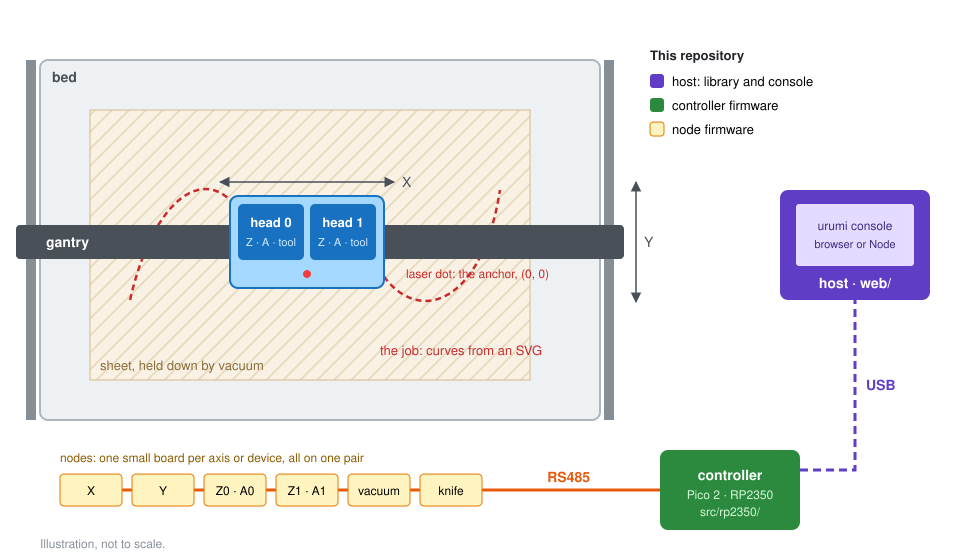

A sheet lies on the bed, held down by vacuum. A gantry moves over it in X,
and a carriage on the gantry moves in Y. The carriage holds two heads, and
each head has a Z that lowers its tool and an A that turns it: a knife, a
crease wheel or a pen. A laser dot on the carriage marks the anchor, the
point everything is measured from.

Three programs share the work, one per layer:

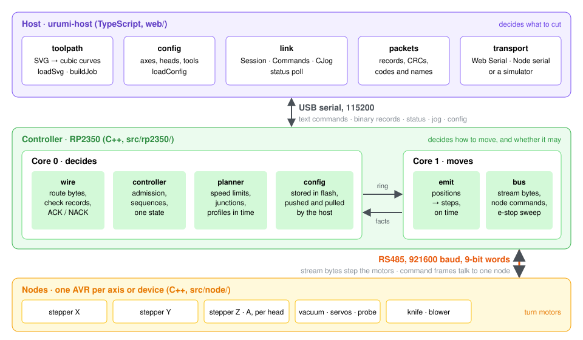

* **The host** decides *what* to cut. It reads an SVG, turns each tool's
  layer into cubic curves, and sends them to the controller while the
  machine cuts. It runs in a browser or in Node.
* **The controller** decides *how* to move, and whether it may. Core 0 checks
  each command and record, plans the motion and publishes one state; Core 1
  turns the plan into steps on time and drives the bus.
* **The nodes** turn motors. Each is a small board on the RS485 bus that
  steps one axis or runs one device, such as the vacuum or the knife.

Words used across this repo:

| Word | Means |
| --- | --- |
| head | a Z and an A that carry one tool |
| node | one board on the bus, for one axis or device |
| anchor | the laser dot, (0, 0) of the carriage; a head's offset is measured from it |
| tool, chamber | what a head carries; a revolver tool has numbered chambers |
| job | one drawing cut from one sheet, sent as records |
| record | one binary message on the USB wire, magic byte first |
| placement | jogging the laser dot to the sheet's corner before a job cuts |

## Hardware

* **Controller:** a Raspberry Pi Pico 2 (RP2350) with a half-duplex RS485
  transceiver, connected to the PC over USB.
* **Nodes:** one small AVR board per axis or device, each with its own RS485
  transceiver, on one bus with the controller:

  | Board | Chip | Runs |
  | --- | --- | --- |
  | ATtiny3224 stepper | ATtiny3224 | a stepper axis |
  | ATtiny3226 vacuum | ATtiny3226 | the vacuum pump, servos and probe switch |
  | DB32 stepper | AVR128DB32 | a stepper axis |
  | DB32 vacuum | AVR128DB32 | the vacuum pump, servos and probe switch |
  | DB32 knife | AVR128DB32 | the oscillating knife and its blower |

* **Stepper drivers:** a DM542, TMC2660 or DRV8825 on each stepper node, set
  by the node's env.
* **For flashing:** a USB cable for the Pico, and a serial UPDI adapter for
  the nodes.

Each board's pins: [docs/system/nodes.md](docs/system/nodes.md).

## Quick start

### Get the code

Clone this repository with the URL from its page: the **Code** button on
GitHub, or **Clone** on GitLab.

```sh
git clone <the repository's URL>
```

You need [VS Code](https://code.visualstudio.com/) with the
[PlatformIO IDE](https://marketplace.visualstudio.com/items?itemName=platformio.platformio-ide)
extension, which VS Code offers when you open the folder. The
[Serial Monitor](https://marketplace.visualstudio.com/items?itemName=ms-vscode.vscode-serial-monitor)
extension is optional, for talking to the Pico by hand. For the config and
the host you also need [Node](https://nodejs.org/) 22.12 or later and
[pnpm](https://pnpm.io/), then once:

```sh
cd web
pnpm install
```

Open the repo's root folder in VS Code (File → Open Folder). PlatformIO reads
`platformio.ini` and lists every env in its sidebar.

### Flash the controller

1. Plug the Pico in over USB.
2. In the PlatformIO sidebar, open **Project Tasks → pico → General** and
   click **Upload**.
3. Then **Project Tasks → pico → Platform → Upload Filesystem Image**. This
   writes the machine's config (below) to the Pico.

### The config

The machine is described by `config/controller.jsonc`: its axes, heads,
tools and nodes. Edit it for your machine, then run **Upload Filesystem
Image** again; a plain **Upload** leaves the config on the Pico as it was.
Every field: [docs/system/config.md](docs/system/config.md).

### Flash a node

Each node has its own env, named after its type and node id. For example,
to flash the vacuum node with id 7:

1. Connect a serial UPDI adapter to the node's UPDI pin and plug the adapter
   into the PC.
2. Choose the adapter's port. Either pick it from the port selector (the plug
   icon) in VS Code's status bar, or name it in the env in `platformio.ini`:

   ```ini
   [env:vac_node7]
   upload_port = COM5
   ```

   With neither, PlatformIO picks a port itself.
3. In the PlatformIO sidebar, open **Project Tasks → vac_node7 → General**
   and click **Upload**.

An env ending in `_dbg` builds a node you can drive
from a PC with `scripts/node_console.py`, with no controller or bus.

### Run the console

The demo in `web/demo` is a machine console in the browser: connect, home,
jog, load an SVG and run it.

```sh
cd web
pnpm install   # once; skip if you did it under Get the code
pnpm demo
```

It opens in your browser. Use Chrome or Edge, which have Web Serial, and press
**Connect** to pick the Pico's port. Close the Serial Monitor first; only one
program can hold the port.

To use the host library in your own software, see [web/README.md](web/README.md).

**Safety.** This drives a real machine: a knife that oscillates and a gantry
that moves fast. Keep the e-stop in reach. The console's **Stop** sends
`stop`, which brakes everything and parks the bus; `unstop` clears it.

## How it talks

### Two languages on one USB wire

The host and the controller share one serial line. Text commands are typed
lines with one reply each, for a person or a program:

```text
home
→ ok
get state busy
→ state=5 busy=1
```

A line you type is shown plain; `→` marks the controller's reply, as
everywhere in [the docs](docs/README.md#notation).

Everything that must be fast or exact is binary: the job's curves, the status,
the replies to a record. Each record starts with a magic byte that names it
and ends with a CRC8 that checks it.

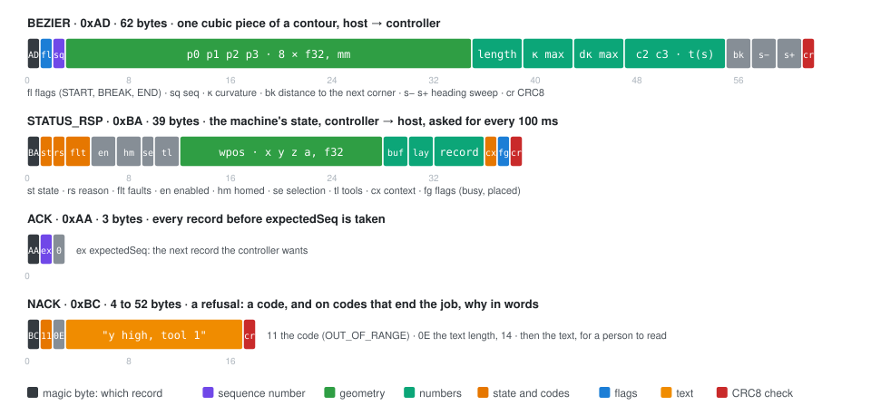

Every layout: [docs/reference/packets.md](docs/reference/packets.md).

### A job streaming

The controller never holds the whole drawing: the host sends a few records
ahead, and each ACK says how far the controller has taken them. A refusal
says why. Some the host waits out and resends; some hold until the operator
acts; the rest end the job.


### A job from start to finish

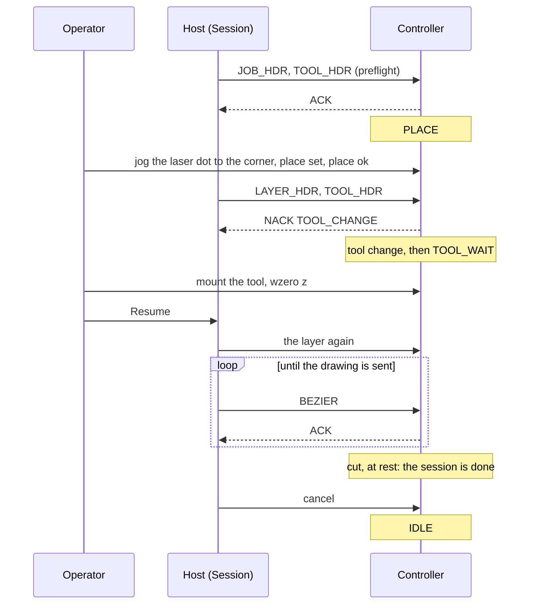

### What the machine is doing

The controller publishes one state, and a reason that refines it. The host
reads both in every status.

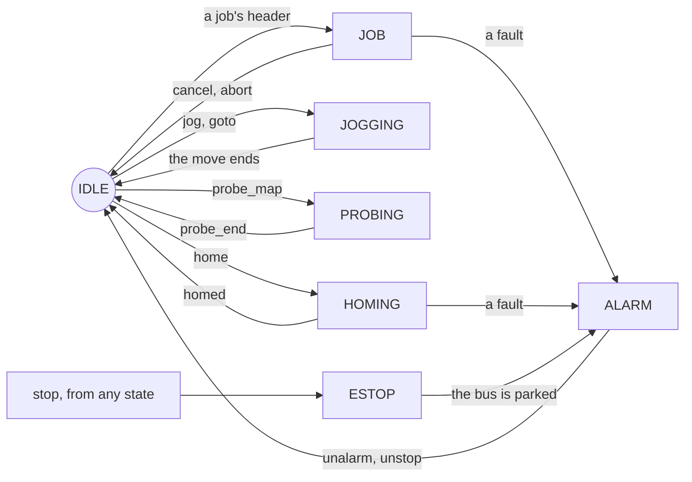

Inside a job, the reason says what the job is doing:

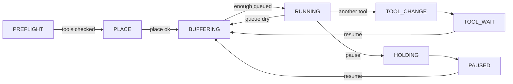

Every state and reason: [docs/system/controller.md](docs/system/controller.md).

### The bus

On RS485 the controller sends two kinds of word. Command frames talk to one
node and wait for its answer. Stream bytes step the motors: one byte carries
a step for up to four nodes at once, and each stepper listens to its own
slot.


How the bus works: [docs/system/bus.md](docs/system/bus.md).

## Where things are

Every position is one point, the selected head's tip or the laser dot, in
one of two frames. Machine coordinates (`mpos`) are fixed by homing. Work
coordinates (`wpos`) count from a zero you set on the material, and each
head's work Z counts from where its tip meets the bed.

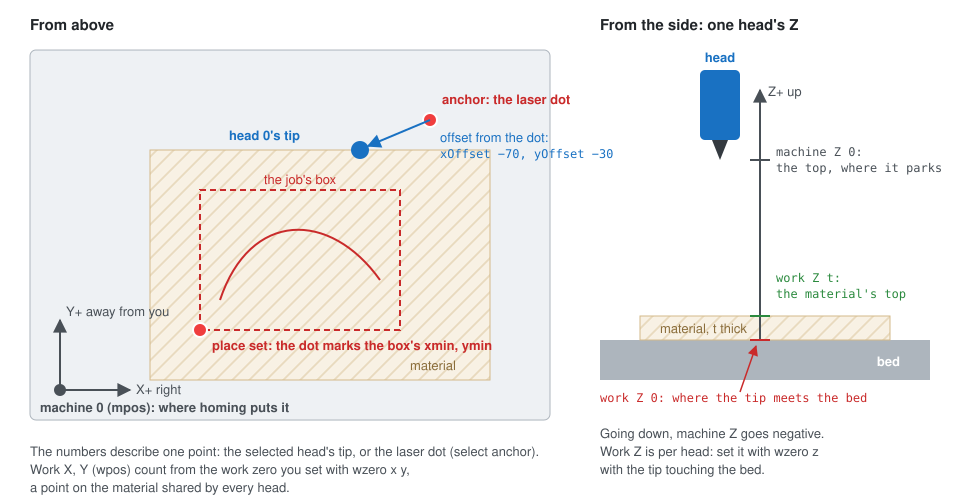

More: [docs/machine/positioning.md](docs/machine/positioning.md).

### What the config describes

The controller knows the machine from one file, `config/controller.jsonc`:
which node drives which axis, where each head sits from the laser dot, the
work area, and the tools.

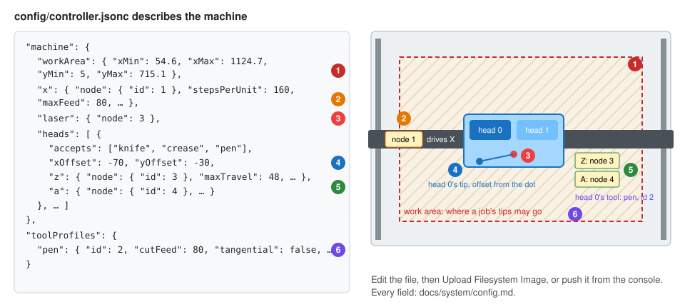

## From a drawing to a cut

Draw in any SVG editor and name each layer after the tool that cuts it. The
host finds those layers, turns their paths into short cubic pieces with
their length and curvature measured, and streams them as records.

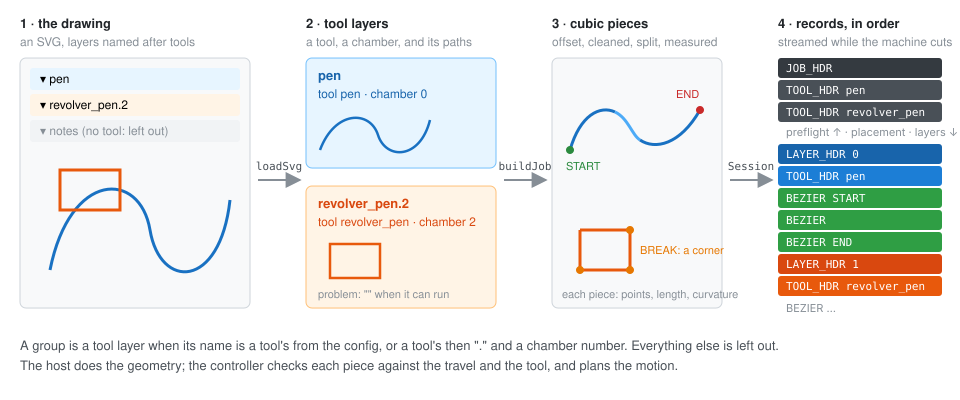

The controller then plans the speed along those pieces, slowing for corners
and tight curves so the tool never takes one faster than the machine can.

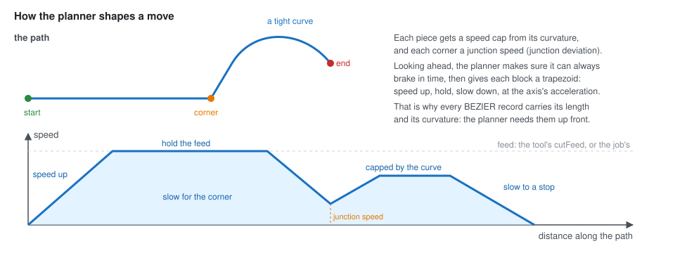

More: [docs/system/jobs.md](docs/system/jobs.md) and
[docs/system/planner.md](docs/system/planner.md).

## Driving it from code

The console is a page over the host library; a program uses the same calls.
Home, read the config off the controller, build a job from an SVG and run it:

```ts
import { WebSerialTransport } from "urumi-host/transport/webserial";
import { MachineState } from "urumi-host/packets";
import { buildJob } from "urumi-host/toolpath";
import { Link, JobSource } from "urumi-host/link";

const link = new Link(await WebSerialTransport.request());
const cmd = link.commands();

await cmd.home();                      // ok means it started
while ((await link.freshStatus()).state !== MachineState.IDLE) {
  await new Promise((r) => setTimeout(r, 500));
}

const config = await link.pullConfig();
const job = buildJob(svgText, config, { thickness: 3, layers: [{ key: "pen", head: 0 }] });
if (!job.ok) throw new Error(job.errors.join("; "));

const session = link.session(new JobSource(job.layers));
const ended = session.run();           // holds "place": jog the dot to the corner, then
await cmd.place("set");
await cmd.place("ok");
console.log(await ended);              // after cancel: { ok: true, … }
```

The library's reference: [docs/reference/host-api/README.md](docs/reference/host-api/README.md).

## When it goes wrong

| You see | It means | Do |
| --- | --- | --- |
| Connect fails, or the port is busy | another program holds it | close the Serial Monitor or another console |
| `→ err not_homed x` | that axis has no position yet | `home` |
| `→ err busy` | something is still moving | wait for `busy=0` in the status |
| `→ err bad_state` | the command isn't taken in this state, such as `wset` during a tool change | read the state; the command's page says when it runs |
| `→ err estop` | the e-stop is latched | `unstop` |
| state ALARM | a fault stopped the machine | read `faults`, fix the cause, `unalarm` |
| `NACK NOT_HOMED` | a job needs an axis that isn't homed | home, then run the job again |
| `NACK OUT_OF_RANGE` with text | part of the job leaves the travel, such as `mesh takes z out` | move the job, or zero Z where there's room to plunge |
| `NACK TOOL_UNAVAILABLE` with text | the head can't run that tool | check `accepts` and the tool's power in the config |
| a resume says "not taken (tool)" | the tool change isn't finished | mount the tool, `wzero z`, then Resume |

Every refusal and its text: [docs/reference/packets.md](docs/reference/packets.md)
and [docs/reference/commands.md](docs/reference/commands.md).

## Folders

| Folder | Holds |
| --- | --- |
| `src/` | the firmware: the controller in `src/rp2350/`, the nodes in `src/node/`, bench firmware in `src/scratch/` |
| `lib/` | firmware libraries shared by the controller and the native tests, such as the planner |
| `include/` | shared firmware headers |
| `test/` | the firmware's native tests |
| `web/` | the host: the `urumi-host` library and its demo ([web/README.md](web/README.md)) |
| `config/` | the machine's config, `controller.jsonc` |
| `data/` | the config image built from `config/`, flashed to the controller (generated) |
| `scripts/` | build hooks, the node console and bench scripts |
| `docs/` | the docs ([docs/README.md](docs/README.md)) |

## Docs

* What the machine does and how it works: [docs/README.md](docs/README.md)
* Building the firmware: [docs/system/firmware-build.md](docs/system/firmware-build.md)
* Building the host: [docs/system/host-build.md](docs/system/host-build.md)
* The host library's API: [docs/reference/host-api/README.md](docs/reference/host-api/README.md)
* Working on the repo: [AGENTS.md](AGENTS.md)
